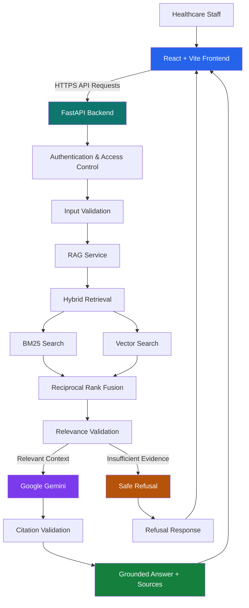
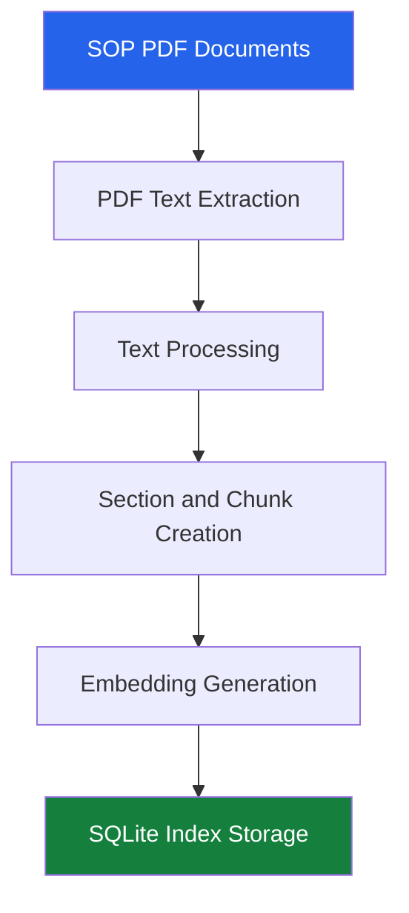
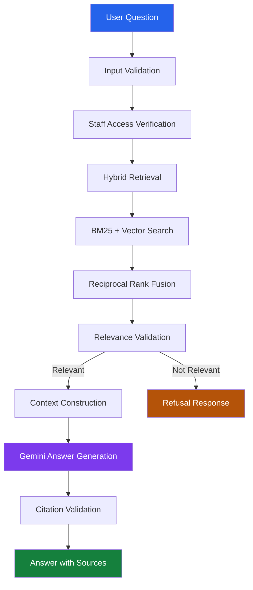

<div align="center">

# MediCare SOP Assistant

### AI-Powered Healthcare Knowledge Retrieval Platform

**Ask questions. Retrieve trusted SOP information. Verify every answer.**

A Retrieval-Augmented Generation (RAG) application that helps healthcare staff access relevant Standard Operating Procedures through natural language queries, hybrid search, and source-grounded AI responses.

<br>

<a href="https://medicare-sop-assistant.vercel.app/">
  
</a>
<a href="https://medicare-sop-assistant.onrender.com/docs">
  
</a>

<br><br>


<br>

**[Live Application](https://medicare-sop-assistant.vercel.app/) · [API Documentation](https://medicare-sop-assistant.onrender.com/docs) · [Source Code](https://github.com/PAWAN0207/-medicare-sop-assistant)**

</div>

---

## 📖 Table of Contents

- [Project Overview](#-project-overview)
- [Why This Project?](#-why-this-project)
- [Key Features](#-key-features)
- [System Architecture](#-system-architecture)
- [How the RAG Pipeline Works](#-how-the-rag-pipeline-works)
- [Technology Stack](#-technology-stack)
- [Testing and Evaluation](#-testing-and-evaluation)
- [Project Structure](#-project-structure)
- [Getting Started](#-getting-started)
- [Deployment](#-deployment)
- [Security and Data Handling](#-security-and-data-handling)
- [Future Improvements](#-future-improvements)
- [Author](#-author)

---

## 🧠 Project Overview

MediCare SOP Assistant is an AI-powered knowledge retrieval application designed to simplify access to healthcare Standard Operating Procedures (SOPs).

Healthcare organizations rely on documented procedures for daily operations. Finding the correct information across multiple documents can take time, particularly when staff need specific instructions.

This application addresses that challenge through a conversational interface backed by a Retrieval-Augmented Generation architecture.

Users can ask questions in natural language and receive answers based on relevant SOP content, supported by document-level citations.

### Project at a Glance

| Area | Details |
|---|---|
| Application | Healthcare SOP Knowledge Assistant |
| Architecture | Retrieval-Augmented Generation |
| Documents Indexed | 15 SOP documents |
| Retrieval Strategy | Hybrid Search |
| Ranking | Reciprocal Rank Fusion |
| Language Model | Google Gemini |
| Backend | FastAPI |
| Frontend | React + Vite |
| Database | SQLite |
| Automated Tests | 74 passed |
| Frontend Hosting | Vercel |
| Backend Hosting | Render |

---

## 🎯 Why This Project?

Traditional document-based workflows often require users to:

- Open multiple PDF documents.
- Search manually for relevant sections.
- Understand lengthy procedural instructions.
- Verify information against the original source.

MediCare SOP Assistant introduces a conversational retrieval layer over approved SOP documents.

**The goal is not simply to generate answers. It is to retrieve relevant evidence, respect user access permissions, and provide traceable responses.**

---

## ✨ Key Features

### 01. Natural Language Question Answering

- Ask questions without knowing the exact document name.
- Retrieve relevant SOP information.
- Generate context-grounded answers using Google Gemini.
- Provide supporting source citations.

### 02. Hybrid Information Retrieval

Combines two retrieval approaches:

| Retrieval Method | Purpose |
|---|---|
| BM25 | Keyword-based retrieval |
| Vector Search | Semantic similarity retrieval |
| Reciprocal Rank Fusion | Combines retrieval rankings |

This approach helps retrieve relevant information using both keyword matching and vector similarity.

### 03. Role-Based Access Control (RBAC)

- Staff-specific access permissions.
- Role-based document access policies.
- Access-filtered retrieval.
- Protection against retrieving documents outside the permitted access scope.

### 04. Source-Level Citations

Responses can include:

- SOP ID.
- Document title.
- SOP version.
- Section information.
- Page reference.

Users can verify generated information against its source document.

### 05. Relevance Filtering and Safe Refusal

The application includes relevance checks before answer generation.

When relevant information cannot be retrieved or the available evidence does not support an answer, the system can return a refusal instead of generating unsupported information.

### 06. Privacy and Input Validation

- PII-related input checks.
- Request validation.
- Controlled document retrieval.
- Separation of confidential source materials from public project documentation.

### 07. PDF Ingestion and Indexing

- PDF text extraction.
- Document metadata preservation.
- Section-aware content processing.
- Text chunking.
- Embedding generation.
- SQLite-based index storage.

---

## 🏗️ System Architecture

The application uses a decoupled frontend and backend architecture.



### Deployment Architecture

| Layer | Technology | Hosting |
|---|---|---|
| Frontend | React + Vite | Vercel |
| Backend | FastAPI + Uvicorn | Render |
| AI Processing | Google Gemini | External API |
| Document Index | SQLite | Backend runtime |

---

## 🔄 How the RAG Pipeline Works

The application has two primary workflows.

### 1. Document Ingestion Pipeline



### 2. Question Answering Pipeline



---

## 🛠️ Technology Stack

| Category | Technology |
|---|---|
| Programming Language | Python |
| Frontend Framework | React |
| Frontend Build Tool | Vite |
| Backend Framework | FastAPI |
| API Server | Uvicorn |
| Large Language Model | Google Gemini |
| Embedding Model | gemini-embedding-001 |
| Retrieval | BM25 + Vector Search |
| Ranking Algorithm | Reciprocal Rank Fusion |
| Database | SQLite |
| PDF Processing | pdfplumber |
| Automated Testing | pytest |
| Frontend Deployment | Vercel |
| Backend Deployment | Render |
| Version Control | Git + GitHub |

---

## 📊 Testing and Evaluation

The application was tested across core functionality, document retrieval, permissions, and end-to-end deployment.

### Test Summary

| Evaluation Area | Result |
|---|---|
| Automated Test Suite | 74 Passed |
| SOP Document Indexing | 15 Documents |
| Retrieval Testing | Passed |
| RBAC Testing | Passed |
| Citation Validation | Passed |
| Refusal Handling | Passed |
| PII Detection Testing | Passed |
| API Testing | Passed |
| Live Deployment Testing | Passed |
| End-to-End Testing | Passed |

### Testing Focus

- Retrieval of relevant SOP content.
- Handling of questions without supporting document evidence.
- Role-specific document access.
- Citation and source validation.
- Input validation and privacy-related checks.
- Frontend-to-backend communication.

*Results reflect the completed project test runs and deployment verification.*

---

## 📁 Project Structure

```text
-med icare-sop-assistant/
│
├── data/                   # Document and data resources
│
├── docs/                   # Project documentation
│
├── frontend/               # React + Vite application
│
├── scripts/                # Utility and project scripts
│
├── sopassist/              # Backend application
│   ├── adapters/           # LLM and model adapters
│   ├── api/                # API components
│   ├── domain/             # Domain models and validation
│   ├── eval/               # Evaluation utilities
│   ├── ingest/              # PDF ingestion and indexing
│   ├── rag/                 # Retrieval and generation
│   ├── store/               # SQLite storage
│   ├── config.py
│   ├── container.py
│   └── main.py
│
├── tests/                  # Automated test suite
│
├── .env.example            # Environment template
├── .gitignore
├── Dockerfile
├── Dockerfile.render
├── docker-compose.yml
├── Makefile
├── requirements.txt
├── AI_USAGE.md
└── README.md
```

*Confidential source documents, staff information, credentials, and sensitive evaluation data should not be published.*

---

## ⚙️ Getting Started

### Prerequisites

- Python 3.12
- Git
- Node.js and npm
- Google Gemini API key for live LLM functionality
- Access to authorized SOP PDF documents for local indexing

### 1. Clone the Repository

```bash
git clone https://github.com/PAWAN0207/-medicare-sop-assistant.git

cd -medicare-sop-assistant
```

### 2. Create a Python Virtual Environment

**Windows PowerShell**

```powershell
py -3.12 -m venv .venv

.\.venv\Scripts\Activate.ps1
```

### 3. Install Backend Dependencies

```powershell
python -m pip install --upgrade pip

pip install -r requirements.txt
```

### 4. Configure Environment Variables

Create a local `.env` file using `.env.example` as the reference.

Example configuration:

```env
PROVIDER=openai_compat

LLM_BASE_URL=https://generativelanguage.googleapis.com/v1beta/openai
LLM_API_KEY=your_gemini_api_key
LLM_MODEL=your_available_gemini_model

EMBED_MODEL=gemini-embedding-001

DATA_DIR=data
DB_PATH=var/sop_index.db
```

Use the actual supported variable names and values defined in the project configuration.

**Security:** Never commit real API keys, passwords, private SOP documents, or staff records.

### 5. Prepare the Document Index

Place authorized SOP PDFs in the configured document directory.

Run:

```powershell
python -m sopassist.ingest.cli data/sops
```

### 6. Start the Backend

```powershell
python -m uvicorn sopassist.main:app --reload --host 127.0.0.1 --port 8000
```

Backend endpoints:

| Service | Local URL |
|---|---|
| API | http://127.0.0.1:8000 |
| Swagger Documentation | http://127.0.0.1:8000/docs |
| Health Check | http://127.0.0.1:8000/healthz |

### 7. Run Tests

```powershell
python -m pytest -v
```

### 8. Start the Frontend

Open a separate terminal:

```powershell
cd frontend
npm install
npm run dev
```

Configure the frontend API environment variable according to the frontend's `.env.example`.

Use the development URL displayed by Vite to open the application.

---

## 🚀 Live Deployment

The project is publicly accessible through the following deployment endpoints.

| Service | URL |
|---|---|
| Web Application | [MediCare SOP Assistant](https://medicare-sop-assistant.vercel.app/) |
| Backend | [Render API](https://medicare-sop-assistant.onrender.com/) |
| Swagger UI | [API Documentation](https://medicare-sop-assistant.onrender.com/docs) |
| Health Check | [Backend Health](https://medicare-sop-assistant.onrender.com/healthz) |

**Deployment Note:** The backend uses a free-tier hosting service. Initial requests after inactivity may take longer because the service can spin down.

---

## 🔐 Security and Data Handling

Healthcare-related documents and staff information require careful handling.

This project demonstrates access control, input validation, and source-grounded retrieval. However, it is a portfolio demonstration and should not be treated as a production-certified healthcare system.

Important considerations:

- Never expose real patient information or confidential healthcare records.
- Do not publish private SOP documents or staff records.
- Store API keys and secrets in environment variables.
- Apply appropriate authentication and authorization before production use.
- Use persistent storage, monitoring, and rate limiting for production deployments.
- Verify all important information against approved organizational procedures.

### Disclaimer

MediCare SOP Assistant is an AI-assisted document retrieval application. It does not replace qualified healthcare professionals, clinical judgement, official policies, or emergency response procedures.

---

## 🔮 Future Improvements

- Persistent production-grade document and vector storage.
- Advanced retrieval and reranking techniques.
- SOP version control and document change tracking.
- Improved monitoring and observability.
- Expanded evaluation and retrieval benchmarks.
- Stronger production authentication and authorization.
- Scalable deployment infrastructure.

---

## 👨‍💻 Author

<div align="center">

### Pawan Ajay Prasad

**AI Engineer | Generative AI | RAG Systems | Machine Learning**

<a href="https://github.com/PAWAN0207">
  
</a>
<a href="https://www.linkedin.com/in/pawan-prasad-analyst/">
  
</a>
<a href="https://pawan0207.github.io/">
  
</a>

<br><br>

**Thank you for visiting this project!**

*Making healthcare SOP information easier to access, retrieve, and verify.*

</div>