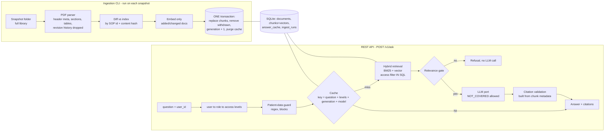

# MediCare SOP Assistant (RAG proof of concept)

Answers clinic-staff questions **only from the current SOPs**, with citations (SOP id, version, section, page), says
"I don't know" when the SOPs don't cover it, enforces **role-based access at retrieval time**, blocks **patient data**,
re-indexes from a **full-library snapshot** incrementally, and caches repeated questions safely.

> The data pack is confidential (D3V). Keep this repository **private**.

## Quick start (5 commands, no API key needed)

```bash
make setup                                   # venv + dependencies + .env (PROVIDER=fake)
make test                                    # offline tests, no key, ~10 s
make run                                     # indexes data/sops, serves http://localhost:8000  (Swagger at /docs)
make ingest SNAPSHOT=data/sop_updates/2026-11-01   # (2nd terminal) apply the update snapshot, prints what changed
make eval                                    # full evaluation -> docs/eval_results.md
```
Or `docker compose up` (copy `.env.example` to `.env` first). On Windows use WSL, or run the `python -m ...` commands in the Makefile directly.

Try it:
```bash
curl -s localhost:8000/v1/ask -H 'content-type: application/json' \
  -d '{"user_id":"U2001","question":"What is the procedure for a needle-stick injury?"}'
```

### Using a real LLM (Gemini free tier or any OpenAI-compatible API)
1. Put your key in `.env` (`.env` is git-ignored and loaded automatically; real environment variables override it):
   `PROVIDER=openai_compat`, `LLM_API_KEY=...` (see `.env.example`).
2. `make check-key` - one chat call + one embedding call; catches a wrong key or retired model name in seconds.
3. If you ran the fake provider before, the index holds fake vectors: `python -m sopassist.ingest.cli data/sops --rebuild`
   (or delete `var/sop_index.db`) once after switching to a real embedder.
4. `make eval-live`, then re-tune `MIN_TERM_COVERAGE` / `MIN_COSINE` from that run.

Step-by-step setup for Windows / macOS / Linux, venv, testing and the GitHub push: **[docs/SETUP.md](docs/SETUP.md)**.

## Architecture



Code layout (`sopassist/`): `domain/` pure business rules (access, PII, text) - `ports.py` LLM/Embedder interfaces -
`adapters/` fake + OpenAI-compatible - `ingest/` parser, indexer, CLI - `store/` SQLite - `rag/` retriever, prompts, service -
`api/` FastAPI - `eval/` evaluation harness. Only `container.py` knows which adapters are used.

## Key design answers (the "engineering points")
| Question | Answer (details in `docs/design_review.md`) |
|---|---|
| How is a document identified across runs? | **SOP id from the PDF header** (stable) + **content hash of normalised extracted content & header metadata** (change detection). File names are ignored (SOP-05 was renamed; file bytes differ on re-export). |
| Where is the access check? | In the SQL that loads candidate chunks (`read_allowed_chunks`), before scoring. Disallowed chunks are never in memory, never ranked, never in the prompt. Role comes from `user_id` server-side, never from the question. Tested with prompt-injection and spy LLM. |
| Cache key? | `sha256(normalised question, sorted access levels, index generation, prompt version, LLM id, embedder id, search mode)`. Levels, not user -> same visibility = shareable, different = never shared. Generation bumps on any content change and old entries are purged in the same transaction. |
| Crash during re-index? | Parse + embed happen first (no writes). All changes are applied in **one SQLite transaction**; a crash rolls back, readers see old or new snapshot, never a mix. Re-running recovers. Tested (crash after embed, mid-apply, concurrent readers). |

## API
OpenAPI: `docs/openapi.json` (live at `/docs`). `POST /v1/ask` `{user_id, question}` ->
`{answer, refused, reason, citations[{sop_id,version,title,section,section_title,page}], cached, index_generation, request_id}`.
Errors always `{"error":{"code","message","request_id","details"}}`: `UNKNOWN_USER` 403, `INVALID_REQUEST` 422,
`PATIENT_DATA_DETECTED` 422 (returns only identifier *types*), `INDEX_EMPTY` 503, `UPSTREAM_ERROR` 502, `UPSTREAM_TIMEOUT` 504, `INTERNAL` 500.
`GET /healthz`. Every response carries `X-Request-ID` (also in every JSON log line, with LLM latency, tokens and cost).

## Failure handling
Timeouts on every external call. **Retried** (with exponential backoff + jitter): embedding and generation calls on timeout, 429, 5xx - they are
read-only, so retrying is safe. **Not retried:** 4xx from the provider, anything that writes (index transaction), and the PII/access checks.
Failed answers are never cached. A bad PDF, duplicate SOP id, empty folder or suspicious mass-withdrawal aborts the whole snapshot with the index untouched.

## Scope and honest status
Done: all Core items; stretch: hybrid search (offline before/after in the eval, meaningful only with a real embedder).
Not done: UI; conflict detection at ingestion (conflicts are surfaced at question time by the prompt); semantic cache; OCR; auth.

## Known limitations
1. **The live LLM adapter has not been exercised against a real provider by the author of this code** - it is covered by mocked-HTTP tests only. Model names/endpoints in `.env.example` must be verified with your key. The committed eval numbers are **offline (fake LLM)**; they do not measure answer quality.
2. Retrieval gate and lexical normalisations were tuned on the offline embedder and on the pack's own questions (optimistic); a held-out check showed 2/12 false refusals. Re-tune with a real embedder.
3. Offline eval: Q04 fails (lexical embedder can't bridge "10 degrees" -> "outside 2 to 8").
4. `user_id` is trusted as given (no authentication) - production needs SSO/JWT in front.
5. PII guard is rule-based: strong for phone/Aadhaar/MRN/DOB/email, weaker for free-text names (needs a title or the word "patient"). Production: add a DLP/NER service behind the same function.
6. Exact-match cache only (normalised text); paraphrases miss. SQLite = single node; at scale move to Postgres+pgvector and a shared cache.
7. Every query loads the permitted chunk vectors from SQLite (fine for ~1,500 chunks); keep an in-memory copy per generation if the library grows.
8. Text-based PDFs with ruled tables only (no OCR, no merged-cell tables). Answer completeness is not judged (needs a human or LLM judge).
